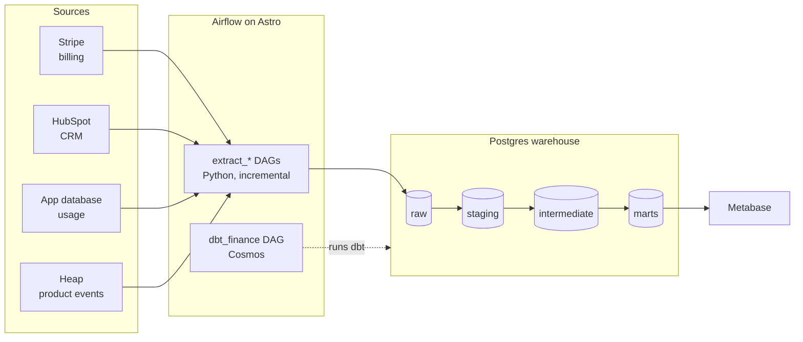

# saas-finance-analytics

An end-to-end analytics pipeline for a subscription (SaaS) business, built around the numbers a finance team reports: **MRR, ARR, churn, retention and MRR movements**.

It pulls billing, CRM and product data with Python, loads it into a Postgres warehouse, models it with dbt, runs on Airflow (Astro + Cosmos) and feeds Metabase. Every revenue number is defined once, tested, and reconciled back to the invoices it came from.

> The data is fake, generated by `include/generate_fake_data.py`, so the whole thing runs without any real accounts or API keys.

## Architecture



1. **Extract and load** (`include/extract/`). One Airflow DAG per source runs hourly. It asks the API only for records changed since the last run (a **watermark** stored in `raw._watermarks`) and upserts them untouched into `raw`, as JSON. Loading the same record twice stores it once.
2. **Transform** (`dbt/`). When every source has landed, the `dbt_finance` DAG starts (it's scheduled on Airflow Assets). Cosmos turns each dbt model into its own task and runs its tests straight after it, so a bad model stops everything downstream.
3. **Serve** (`docs/metabase.md`). Metabase reads only the `marts` schema.
4. **Protect personal data** (`docs/privacy.md`). Personal emails never leave staging, and customers who ask to be forgotten have their personal fields removed from every layer, while their invoices and MRR history stay.

## The dbt project

| Layer | What happens | Examples |
|---|---|---|
| `staging` | One model per raw table. Unpack the JSON, rename, cast types, cents to euros. No joins. | `stg_stripe__invoices`, `stg_hubspot__deals` |
| `intermediate` | The hard logic, kept out of the marts. | `int_customer_ids` matches each Stripe customer to HubSpot (by Stripe ID, then email domain) and the app. `int_invoice_months` spreads each invoice over the months it pays for. |
| `marts/finance` | What finance reads. | `fct_mrr` (one row per customer per month), `fct_mrr_movements`, `rpt_mrr_monthly`, `dim_customers`, `dim_plans` |
| `marts/growth` | Product usage. | `fct_usage_daily` |
| `marts/sales` | Pipeline. | `fct_pipeline` |
| `snapshots` | History Stripe doesn't keep. | `snap_stripe_subscriptions`: what plan was a customer on in March? |

How each metric is calculated, and every rule behind it (failed payments, discounts, yearly plans, currencies), is in **[docs/metric_definitions.md](docs/metric_definitions.md)**.

### Tests (61 data tests, 1 unit test, 8 DAG tests)

- **Reconciliation:** invoiced amount = MRR recognised + amount deferred to future months (`assert_mrr_ties_to_invoices`).
- **Movements balance:** starting MRR + new + reactivation + expansion − contraction − churn = ending MRR, every month.
- **Unit test:** `test_mrr_movement_types` feeds fixed rows into `fct_mrr_movements` and checks each label.
- **Grain:** one row per customer per month in `fct_mrr` and `fct_mrr_movements`, one per account per day in usage.
- **Privacy:** no personal email or phone column in any marts table (`assert_no_personal_emails_in_marts`), and no personal data left for erased customers (`assert_erased_customers_have_no_personal_data`).
- **Generic:** `unique`, `not_null`, `relationships`, `accepted_values` across staging and marts.
- **Freshness:** a warning if a source wasn't loaded in 12 hours, an error after 24.
- **DAG integrity** (`tests/dags`): every DAG loads, has retries and a failure alert, and the dbt DAG has a task per model.

### Sample output (fake data)

`rpt_mrr_monthly`, latest months:

| month | MRR (€) | ARR (€) | paying customers | new | expansion | contraction | churned | NRR |
|---|---:|---:|---:|---:|---:|---:|---:|---:|
| 2026-11 | 14,154 | 169,852 | 71 | 946 | 110 | 300 | 1,392 | 88.9% |
| 2026-10 | 14,295 | 171,534 | 70 | 863 | 410 | 0 | 570 | 98.8% |
| 2026-09 | 13,591 | 163,091 | 67 | 1,940 | 520 | 410 | 199 | 99.2% |

## Run it

### Option A: quick, without Airflow

Needs Python 3.12 and Docker.

```bash
make setup     # virtualenv with dbt, sqlfluff, pytest
make up        # Postgres warehouse on :5433 and Metabase on :3000
make all       # fake data -> extract -> dbt build
make docs      # dbt docs and lineage graph on :8080
```

### Option B: the real thing, with Airflow

Needs the [Astro CLI](https://www.astronomer.io/docs/astro/cli/install-cli).

```bash
cp .env.example .env
make data            # create the fake API files
astro dev start      # Airflow on :8080, plus the warehouse and Metabase from docker-compose.override.yml
```

In the Airflow UI, turn on the `extract_*` DAGs. `dbt_finance` starts by itself once they've all run. Then connect Metabase: see [docs/metabase.md](docs/metabase.md).

## How a change ships

1. Work on a branch and open a pull request.
2. **CI** (`.github/workflows/ci.yml`) loads fake data into a throwaway Postgres, checks a second load adds nothing, runs `dbt build` into its own `ci_<run id>` schemas, checks freshness, lints the SQL with sqlfluff, and runs the DAG integrity tests against the same Airflow version as the Astro image.
3. Review and merge.
4. **Deploy** (`.github/workflows/deploy.yml`) runs `astro deploy` once CI passes on `main`.

## Project layout

```
dags/                   extract_sources.py (one DAG per source), dbt_finance.py (Cosmos)
include/
  extract/              sources.py, clients.py (fake + real Stripe), load.py (watermark + upsert)
  privacy/erase_raw.py  strip personal fields from raw for customers on the erasure list
  generate_fake_data.py
  run_extract.py        run extract without Airflow
  alerts.py             Slack alert on task failure
dbt/
  models/               staging/, intermediate/, marts/{finance,growth,sales}
  macros/               cents_to_units, months_between, reporting_month, generate_schema_name
  seeds/                plan_prices.csv, fx_rates.csv, privacy_erasures.csv
  snapshots/            snap_stripe_subscriptions
  tests/                reconciliation, balance and privacy tests, generic grain test
tests/dags/             DAG integrity tests
docs/                   metric definitions, Metabase guide, personal data and GDPR
.github/workflows/      ci.yml, deploy.yml
Dockerfile              Astro Runtime + dbt in its own virtualenv
docker-compose.override.yml   local warehouse + Metabase
```

## Design choices

- **Raw stays raw.** Records land as JSON exactly as the API sent them, so any model can be rebuilt from the original data.
- **dbt in its own virtualenv** on Astro, so dbt and Airflow never fight over package versions.
- **Separate schemas per environment.** Dev builds into `dev_*`, CI into `ci_<run id>_*`, prod into clean `staging`, `intermediate`, `marts`.
- **Fixed FX rate** for reporting, so exchange-rate swings don't pass as expansion or contraction.
- **Delete the person, keep the invoice.** A GDPR erasure nulls name and email but keeps IDs and amounts, because finance must keep invoices for the legal retention period.
- **Failed payments count as churn**, then reactivation if the customer pays again. It's the stricter view; switch it in `int_invoice_months` if finance prefers otherwise.

## What I'd add next

- Real clients for HubSpot, the app database and Heap (the Stripe one is in `include/extract/clients.py`).
- Cohort retention (12-month NRR by signup month) and unit economics (CAC, LTV) once marketing spend is loaded.
- A dbt semantic layer (MetricFlow), so Metabase and any AI analytics tool query the same metric definitions.
- Incremental models for usage once the event volume grows.
